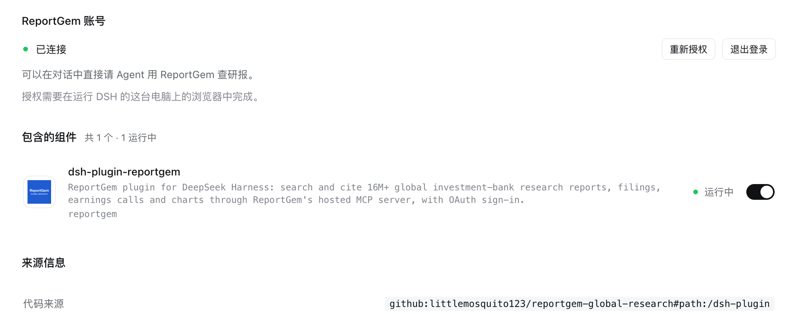
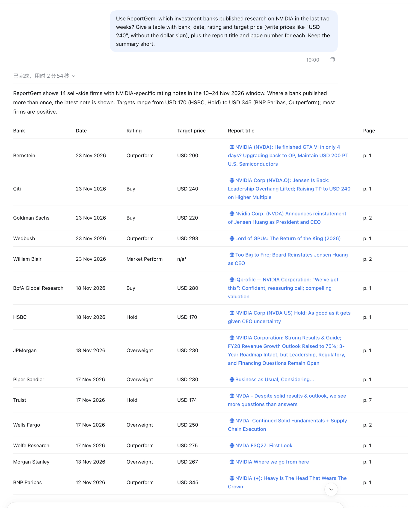

# ReportGem plugin for DeepSeek Harness

Search and cite global investment research inside [DeepSeek Harness](https://github.com/deepseek-ai/deepseek-harness) (`dsh`): 16 million+ reports from global investment banks (Goldman Sachs, Morgan Stanley, JPMorgan, UBS, Citi, HSBC and more), 5 million+ Chinese broker reports, company filings, earnings-call notes and charts. Answers come with source links and page numbers.

The plugin registers ReportGem's hosted MCP server (`https://www.reportgem.com/mcp`) with DSH's MCP manager and adds a **Connect ReportGem** card to the Plugins page. Sign-in uses OAuth; no API key.

## Requirements

- DeepSeek Harness **0.2.3-alpha.2 or later** (MCP OAuth landed in this version).
- A ReportGem account. New accounts get 10 free credits (about 100,000 returned tokens). Sign up at [reportgem.com](https://www.reportgem.com).

## Install

From the command line (npm package [`dsh-plugin-reportgem`](https://www.npmjs.com/package/dsh-plugin-reportgem)):

```sh
dsh plugin --profile web add dsh-plugin-reportgem
```

Or open **Plugins → Add plugin** in the DSH web UI and enter `dsh-plugin-reportgem`. Installing from GitHub also works:

```sh
dsh plugin --profile web add "git+https://github.com/littlemosquito123/reportgem-global-research.git#path:/dsh-plugin"
```

Then open the **dsh-plugin-reportgem** page under Plugins, click **Connect ReportGem**, sign in to ReportGem in the browser and approve. Finish within 10 minutes: DSH stops waiting for the browser after that, and you can click Connect again.

## Use

Ask in any session, for example:

- "Use ReportGem: which banks published research on NVIDIA in the last two weeks? List bank, date, rating or target price, with source links and pages."
- "用 ReportGem 查一下最近一个月投行对宁德时代的观点，附原文页码。"

Tools appear as `mcp__reportgem__search_research`, `search_filings`, `search_meetings`, `search_visuals` and `get_evidence`. They load on demand, so the agent pulls in only the ones it needs.

## Screenshots

Plugin connected (DSH Plugins page):



A query with DeepSeek-V4.1-Flash on 2026-11-24: NVIDIA notes from 14 banks in the last two weeks, with ratings, target prices, report titles and page numbers. It took 2 min 54 s.



## Tested

Installed and run on DeepSeek Harness 0.2.3-alpha.2 (macOS, web profile) on 2026-11-23: OAuth connect, tool loading and a multi-step research query with DeepSeek-V4.1-Flash all worked.

## Free trial and pricing

Free to try: new ReportGem accounts get 10 free credits (about 100,000 returned tokens). After that you pay only for delivered research text (1 credit = 10,000 returned tokens). Titles, your questions, URLs and empty results are free. See [MCP setup & pricing](https://www.reportgem.com/en/mcp.html).

---

# ReportGem 插件（DeepSeek Harness）

在 DeepSeek Harness 里检索、引用全球投行研报：1,600 万+ 份全球投行研报（高盛、摩根士丹利、摩根大通、瑞银、花旗、汇丰等），500 万+ 份国内券商研报，以及公告、业绩会纪要和图表，答案附来源链接和页码。

安装（npm 包 `dsh-plugin-reportgem`）：

```sh
dsh plugin --profile web add dsh-plugin-reportgem
```

也可以在 DSH 网页版“插件 → 添加插件”里输入 `dsh-plugin-reportgem`。

装好后在“插件”里打开 **dsh-plugin-reportgem**，点 **连接 ReportGem**，在浏览器里登录并同意授权（10 分钟内完成）。需要 DeepSeek Harness 0.2.3-alpha.2 及以上版本。可以免费试用：新账号赠送 10 积分（约 10 万 token 返回资料），用完后按积分计费。

截图：[插件已连接](https://raw.githubusercontent.com/littlemosquito123/reportgem-global-research/main/docs/dsh/dsh-connected.png)、[英伟达研报查询结果](https://raw.githubusercontent.com/littlemosquito123/reportgem-global-research/main/docs/dsh/dsh-nvidia-query.png)（2026-11-24，DeepSeek-V4.1-Flash，14 家投行，含评级、目标价、报告标题和页码）。
